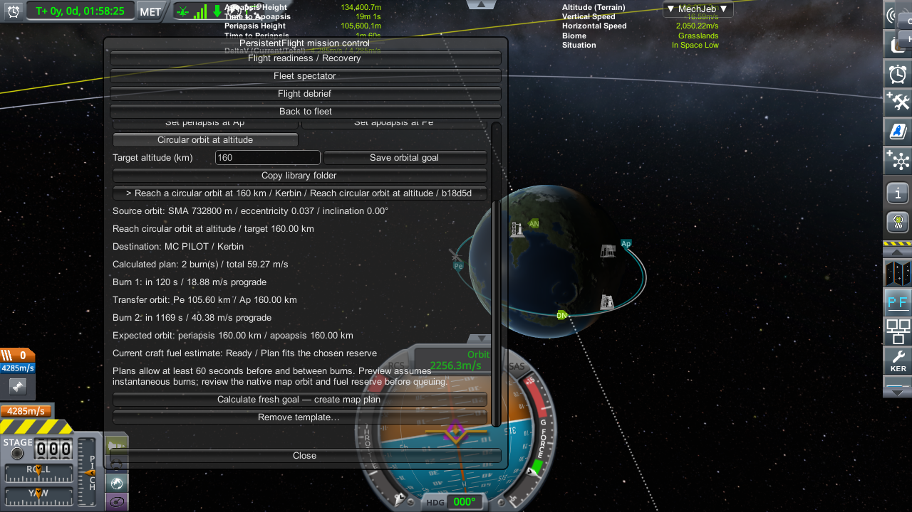

# PersistentFlight

**Background flight and mission control for Kerbal Space Program 1, with kOS automation.** Keep nearby, opted-in craft running in regional physics; prepare supported orbital burns for distant craft; organize missions, templates, recovery, and flight reports through the **PF** panel.

**Current release: 0.25 Experimental.** Tested with **Windows x64 KSP 1.12.5, kOS 1.6.0.1, and ModuleManager 4.2.3**. Compatibility with other versions, operating systems, and physics-changing mods has not been established. This is an experimental mod: start with a separate save and keep backups.

## Download and install

1. Download **PersistentFlight-0.25-Experimental-GitHub.zip** from [Releases](https://github.com/Chris86002/PersistentFlight/releases). Choose the packaged mod asset; GitHub's automatic “Source code” archives are for development.
2. Install [kOS](https://github.com/KSP-KOS/KOS/releases) and [ModuleManager](https://github.com/sarbian/ModuleManager/releases) into your KSP installation if needed. They are required and are not bundled here.
3. Close KSP. Extract the complete PersistentFlight ZIP to a folder outside the game directory.
4. Run **Install.cmd**, then select the KSP folder containing `KSP_x64.exe` when prompted. The installer checks dependencies and all 14 payload hashes, backs up overwritten files, and installs the mod and kOS scripts.
5. Start KSP. Put a kOS CPU on each craft you want to automate. In flight or map view, open the cyan **PF** icon on the stock toolbar.

For nearby live flight, opt each CPU into **Automatic regional physics**. For orbital automation, follow the short mission example below. See [installation, upgrades, and removal](docs/INSTALLATION.md) if setup fails or you prefer manual installation.

## First orbital mission

Use an idle craft in a safe vacuum orbit around the current body, at normal time. Activate suitable engines and make sure no other guidance program owns throttle or steering. Start the supplied cooperative pilot from its kOS terminal:

```kerboscript
RUNPATH("0:/pf_mission_pilot.ks").
```

An optional engine tag selects only that group; replace the example tag with your craft's actual tag:

```kerboscript
RUNPATH("0:/pf_mission_pilot.ks", "UPPER_ENGINE").
```

1. Open **PF → Mission templates**. Enter a name, select **Circular orbit at altitude**, and enter the target altitude in kilometres.
2. Save the orbital goal and select it to preview the burns, transfer orbit, final orbit, total delta-v, and fuel advisory.
3. Select **Calculate fresh goal** to create the map plan. Inspect its nodes in the native map.
4. In **Mission actions**, select **Queue entire flight plan**. Review readiness before switching focus. Leave enough preparation time for the craft's burn duration; a future node roughly 90 seconds away is a useful starting point, not a guarantee for every engine.

Previewing or creating a map plan does **not** start thrust. Queueing hands the reviewed plan to the mission system. Queues can contain up to 32 supported chronological nodes. Recovery can restore the known mission pilot after a reload; arbitrary kOS program memory is not checkpointed.

## What it can do

| Feature | What you get |
| --- | --- |
| Regional autonomy | Nearby opted-in vessels run in private regional physics, within a configurable 5–60 km region. |
| Orbital automation | Cooperative maneuver pilot, saved queues, and supported distant analytic orbital burns. |
| Mission templates | Reusable maneuver sequences and same-body orbital goals, including a transfer and circularization at a chosen altitude. |
| Mission control | Fleet status, readiness, timing, capacity reservations, and a spectator view. |
| Predictive checks | Fuel estimates, reserves, and safety/readiness feedback before supported missions. |
| Events and rovers | Event-driven mission hooks and saved rover routes, with supplied kOS examples. |
| Recovery and reports | Whole-save recovery points, pilot resume support, interruptions, debriefs, and landing reports. |
| SOI flight plans | Separate policies and checks for supported sphere-of-influence flight plans. |

## How background flight works

The mod has two different execution paths. Nearby craft can use regional physics and their running kOS guidance. Supported distant vacuum orbital burns use an analytic model and stored mission state. Scheduling distant burns does not make every distant craft run live physics or execute an arbitrary kOS script continuously.

The regional range is capped at **60 km**. Atmospheric ascent, landing, collisions, and rover driving are not universally simulated at unlimited distance. The included ascent and return programs are craft-specific demonstrations, not universal autopilots. Orbital goal templates preserve the existing plane and do not plan rendezvous, inclination changes, or interplanetary transfers. Finite-duration burns can differ from instantaneous preview predictions.

Templates are stored separately at `saves/<campaign>/PersistentFlight/MissionTemplates`. Back up that library as well as your saves. Whole-save recovery rewinds the campaign and does not roll back the separate template library.

## Guides

- [Installation and uninstall](docs/INSTALLATION.md)
- [Features and detailed operating guides](docs/FEATURES.md)
- [Troubleshooting](docs/TROUBLESHOOTING.md)
- [Architecture and building from source](docs/DEVELOPMENT.md)
- [Changelog](CHANGELOG.md), [validation scope](docs/VALIDATION.md), and [contributing](CONTRIBUTING.md)



## Source and license

Source is in [`Source/PersistentFlight`](Source/PersistentFlight). The runtime payload is in `GameData/PersistentFlight` and `Ships/Script`. KSP, Unity, kOS, and ModuleManager assemblies are not redistributed as build dependencies.

Licensed under [GNU GPL v3.0](LICENSE), consistent with the existing mission pilot's GPL-3.0 declaration. Kerbal Space Program belongs to its respective owners. This is an unofficial community mod.
